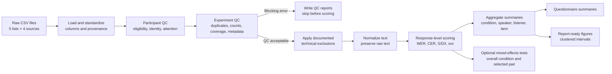

# Transcription experiment analysis

This repository provides a reusable, auditable pipeline for quality-controlling, scoring, summarizing, and visualizing a counterbalanced human transcription experiment. The core pipeline uses only the Python standard library; the optional mixed-effects analysis uses the dependencies declared in `mixed-effects`. Raw CSV files remain unchanged, and the pipeline stops before scoring when the experiment structure is incomplete.

The current experiment is configured for:

- 5 counterbalanced lists;
- 3 eligible participants per list;
- 5 audio conditions;
- 3 independent transcriptions for every `utterance_id × condition` pair; and
- hard eligibility requirements: `native_english=TRUE`, `headphones=TRUE`, and `heard_clearly=TRUE`.

Experiment-specific assumptions, labels, aliases, exclusions, and thresholds live in `config/analysis_config.json`. The Python modules contain the reusable analysis logic.

## Repository description

### Pipeline overview



The main safety boundary is between QC and scoring. All QC reports are written first. If a structural requirement fails and `fail_on_structural_qc` is enabled, the run stops before producing scores or summaries.

### Repository structure

```text
.
├── run_analysis.py
├── run_mixed_effects.py
├── config/analysis_config.json
├── src/transcription_analysis/
│   ├── cli.py
│   ├── config.py
│   ├── io_utils.py
│   ├── schema.py
│   ├── pipeline.py
│   ├── normalize.py
│   ├── metrics.py
│   ├── mixed_effects.py
│   ├── summarize.py
│   ├── timing.py
│   ├── questionnaire.py
│   └── visualize.py
├── tests/
│   ├── test_metrics.py
│   ├── test_mixed_effects.py
│   ├── test_pipeline.py
│   └── test_timing.py
└── results/
```

| Module | Responsibility |
| --- | --- |
| `run_analysis.py`, `cli.py` | Parse paths, protect input/output boundaries, run the pipeline, and report status. |
| `config.py` | Load the JSON configuration and validate required sections. |
| `io_utils.py` | Read and write CSV/JSON files and preserve source provenance. |
| `schema.py` | Resolve column aliases, create canonical fields, and identify duplicates. |
| `pipeline.py` | Coordinate loading, QC, exclusions, scoring, summaries, and outputs. |
| `normalize.py` | Apply conservative text normalization and locate configured name spans. |
| `metrics.py` | Calculate edit distance, S/D/I counts, WER, CER, and name-aware alignments. |
| `mixed_effects.py` | Test the overall condition effect and an optional selected condition pair while accounting for repeated listeners and utterances. |
| `summarize.py` | Aggregate results at condition, speaker, listener, item, and list levels. |
| `timing.py` | Produce non-blocking session-timing review diagnostics. |
| `questionnaire.py` | Summarize categorical responses and preserve free-text comments. |
| `visualize.py` | Generate SVG figures and the CSV data used to draw them. |
| `tests/` | Exercise reusable code on synthetic data; tests run separately from real analysis. |

### Data flow and auditability

Raw files are never edited. As rows are loaded, the pipeline records their containing `list_id`, `source_file`, and `source_row`. Alternative column names are mapped to canonical names through configuration rather than by renaming raw data.

The pipeline processes the data in the following stages, and each output builds on the previous stage:
1. `eligible_transcriptions.csv` contains non-attention responses retained after participant QC and approved row-level exclusions.
2. `normalized_transcriptions.csv` adds normalized and name-excluded scoring text without outcome metrics.
3. `transcription_scores.csv` adds response-level WER, CER, S/D/I counts, and diagnostics.
4. Summary tables aggregate response-level scores without replacing them as the source of truth.
5. Plot-data CSVs contain the exact values used in every figure.

### Participant inclusion and experiment validity

The pipeline writes QC reports before calculating outcome metrics.

The three eligibility fields are `native_english`, `headphones`, and `heard_clearly`. All three must parse as true (accepted true values are `TRUE`, `true`, `1`, `yes`, `y`, and `t`). The final participant decision also requires matching participant/session identities, correct list membership, configured trial counts when enabled, and passing attention checks unless a documented override exists.

A participant is included only when:

- matching main, prescreen, and sound-check records exist for the same participant and session;
- those records belong to the same list;
- `native_english`, `headphones`, and `heard_clearly` are true;
- configured scored-trial and attention-check counts match; and
- every available attention check passes or has a valid explicit override.

A missing postquestionnaire is a warning. A questionnaire belonging to a conflicting list is an identity inconsistency. Every participant decision and reason appears in `01_qc/participant_qc.csv`.

After participant decisions, structural QC checks whether the resulting dataset still satisfies the experimental design. A participant may fail eligibility, but the experiment can proceed if a valid replacement preserves participant counts and counterbalanced coverage.

The pipeline checks:

- file and folder structure;
- required schemas;
- participant/session identity consistency across sources;
- reported list IDs against containing folders;
- duplicate participant records and repeated trials;
- included participant counts per list;
- expected conditions within every list;
- utterance × condition counterbalancing and independent ratings;
- consistent reference text and speaker metadata per utterance; and
- missing, negative, non-monotonic, unusually short, or unusually long timing.

Timing flags and missing postquestionnaires are review diagnostics. They do not automatically exclude a participant or stop analysis unless they reveal another identity or structural problem.

### Normalization and scoring

The raw reference and transcription are always preserved. The default normalized score applies only:

- Unicode normalization;
- lowercasing;
- apostrophe standardization;
- apostrophe removal without splitting the word (`aren't` becomes `arent`);
- punctuation removal;
- whitespace cleanup;
- explicitly configured word equivalences; and
- configured personal-name exclusion from WER and CER.

It does not correct guessed words, perceptual errors, or `xxx`. Number conversion is not enabled. The current pre-agreed mappings are `theatre → theater`, `neighbours → neighbors`, and `spelt → spelled`. Record any additional mapping decision before comparing systems.

Each eligible non-attention response receives three score variants:

| Score variant | Purpose |
| --- | --- |
| `raw_wer`, `raw_cer` | Sensitivity view before normalization. |
| `wer_with_names`, `cer_with_names` | Normalized scoring with personal names included. |
| `wer`, `cer` | Primary normalized score after configured personal-name exclusion. |

#### WER and CER

```text
WER = (word substitutions + word deletions + word insertions) / reference words
CER = (character substitutions + character deletions + character insertions) / reference characters
```

CER removes spaces by default. Set `normalization.cer_remove_spaces` to `false` if spaces should count as characters. A blank transcription is retained and scored as deletion of the complete reference. A missing transcription column remains a blocking schema error.

#### Mixed-effects condition analysis

A post-hoc analysis fits linear mixed-effects models for WER and CER:

```text
WER or CER ~ condition + speaker + (1 | listener) + (1 | utterance)
```

Condition and speaker are fixed effects. Listener and utterance are crossed random intercepts, accounting for repeated measurements from the same listener and repeated use of the same utterance. The overall condition result is a joint Wald chi-square test of all condition coefficients; significance means at least one condition differs.

A selected comparison tests one condition against another within the same fitted model. It reports `FIRST − SECOND`, its standard error, 95% confidence interval, Wald z statistic, and two-sided p-value. A negative difference means the first condition has the lower error rate. No multiplicity correction is applied because one comparison is selected per run; choose that pair before inspecting its p-value.

#### Personal-name exclusion

Names in `normalization.excluded_name_phrases` are matched in the normalized reference and represented as wildcard spans. A wildcard can absorb the listener's rendering of that name, including a misspelling, without contributing an error. Surrounding words remain scored.

Review `reference_text_scored`, `transcription_scored`, `excluded_name_phrases`, and the difference between name-included and primary scores. Because wildcard alignment intentionally removes uncertain name spans, review every name-excluded response before final reporting to ensure neighboring non-name errors were not absorbed.

#### Macro and pooled results

`mean_wer` and `mean_cer` are macro averages: every response-level error rate receives equal weight.

`micro_wer` is pooled:

```text
micro WER = total word errors / total reference words
```

Longer references contribute more weight to pooled rates. The condition WER/CER figure and error-composition figure both use means of response-level rates. Therefore, the stacked substitution, deletion, and insertion rates equal the reported macro mean WER or CER for each condition.

#### `xxx` diagnostics

The exact normalized token `xxx` is included in WER/CER as an ordinary hypothesis token and reported separately. Diagnostics include any `xxx`, whole-response `xxx`, token count, and token rate. Variants such as `xx`, `xxxxx`, or free-text descriptions of uncertainty are not automatically treated as `xxx`.

### Outputs, questionnaire, and figures

Scores are summarized by condition, speaker, speaker-condition, listener, listener-condition, utterance, utterance-condition, list-condition, and gender-condition when gender is available. Outputs include sample counts, macro WER/CER, pooled word-error rates, S/D/I rates, `xxx`, perfect-transcription rates, timing, and playback diagnostics.

The postquestionnaire remains descriptive. Categorical responses are counted overall and within each list. Comments are preserved verbatim with participant/session identifiers. Labels such as “Very easy” and “Good” are not converted to numbers because equal spacing between categories has not been established. Questionnaire responses provide diagnostic context rather than automatically changing intelligibility scores.

The pipeline generates six vector figures:

- response-level WER and CER box-and-dot distributions by condition;
- gender × condition mean WER and CER;
- speaker × condition mean WER and CER;
- word-level and character-level S/D/I composition by condition;
- partial and whole-response `xxx` rates by condition; and
- inter-listener WER/CER variation by condition.

Error-rate intervals use a participant-clustered percentile bootstrap with a fixed random seed. Participants are sampled with replacement and their responses remain together within each resample. These intervals describe listener-level uncertainty; they do not replace a preregistered mixed-effects analysis. Gender and speaker results describe the four speakers in this experiment and must not be interpreted as population-level gender effects.

#### Inter-listener consistency

The pipeline measures variation in WER and CER across listeners for each `utterance_id × condition` group. It reports the sample standard deviation and range of the listener scores.

The condition-level summary uses only groups containing the configured number of distinct listeners. Incomplete groups remain visible in the detailed utterance-condition output and are counted separately.

Lower variation indicates that listeners produced more similar accuracy scores for the same audio. This analysis complements the participant-clustered confidence intervals: confidence intervals describe uncertainty in a condition-level mean, whereas inter-listener variation describes consistency among listeners evaluating the same audio. With only three listeners per group, these values are descriptive and should not be interpreted as formal reliability coefficients.

### Output structure

```text
analysis_output/
├── run_manifest.json
├── OUTPUT_GUIDE.md
├── 01_qc/
│   ├── qc_summary.txt
│   ├── source_file_inventory.csv
│   ├── participant_qc.csv
│   ├── qc_issues.csv
│   ├── duplicate_transcriptions.csv
│   ├── attention_check_audit.csv
│   ├── attention_check_summary.csv
│   ├── technical_exclusion_audit.csv
│   ├── session_timing_qc.csv
│   ├── list_condition_coverage.csv
│   ├── utterance_condition_coverage.csv
│   └── utterance_metadata_audit.csv
├── 02_preprocessed/
│   ├── eligible_transcriptions.csv
│   └── normalized_transcriptions.csv
├── 03_scores/
│   ├── transcription_scores.csv
│   └── xxx_diagnostics.csv
├── 04_summaries/
│   ├── by_condition.csv
│   ├── by_speaker.csv
│   ├── by_speaker_condition.csv
│   ├── by_gender_condition.csv
│   ├── by_listener.csv
│   ├── by_listener_condition.csv
│   ├── by_utterance.csv
│   ├── by_utterance_condition.csv
│   ├── by_list.csv
│   ├── plays_wer_summary.csv
│   ├── inter_listener_consistency_by_utterance_condition.csv
│   ├── inter_listener_consistency_by_condition.csv
│   └── technical_exclusion_sensitivity.csv
├── 05_questionnaire/
│   ├── eligible_responses.csv
│   ├── categorical_summary.csv
│   └── comments.csv
├── 06_figures/
│   ├── condition_plot_data.csv
│   ├── error_rate_distribution_plot_data.csv
│   ├── gender_condition_plot_data.csv
│   ├── speaker_condition_plot_data.csv
│   ├── inter_listener_consistency_plot_data.csv
│   ├── error_rate_distributions.svg
│   ├── gender_error_rates.svg
│   ├── speaker_error_rates.svg
│   ├── error_composition.svg
│   ├── xxx_rates.svg
│   └── inter_listener_consistency.svg
└── 07_mixed_effects/                  # Optional; generated separately
    ├── condition_effect_tests.csv
    ├── selected_condition_comparison.csv  # Only with --compare-conditions
    ├── condition_effect_summary.txt
    └── model_audit.json
```

`transcription_scores.csv` is the response-level analytical source of truth. `by_condition.csv` is the primary descriptive system comparison. `technical_exclusion_sensitivity.csv` is created only when approved technical exclusions are applied, and `by_gender_condition.csv` is created only when gender metadata are available.

For mixed effects, `condition_effect_tests.csv` contains the omnibus WER/CER tests, `selected_condition_comparison.csv` contains the optional chosen pair, `condition_effect_summary.txt` gives the plain-language conclusions, and `model_audit.json` records the model specification, convergence, diagnostics, selected pair, and input hashes.

## Instructions for using the repository

### Requirements

- Python 3.9 or newer;
- no third-party packages for the core pipeline; optional mixed-effects dependencies are installed separately; and
- an empty or new output directory for each run.

### Expected input folders

Place this repository beside `results`, or pass another path with `--results-root`.

```text
results/
├── pilot_transcription_experiment_list1/
│   ├── main/*.csv
│   ├── prescreen/*.csv
│   ├── sound_check/*.csv
│   └── postquestionnaire/*.csv
├── pilot_transcription_experiment_list2/
│   └── ...
├── pilot_transcription_experiment_list3/
│   └── ...
├── pilot_transcription_experiment_list4/
│   └── ...
└── pilot_transcription_experiment_list5/
    └── ...
```

Each folder may contain one CSV per participant. Files are discovered with `*.csv`; filenames do not control joins.

| Source | Required fields |
| --- | --- |
| `main` | `participant_id`, `session_id`, `item_id`/`utt_id`/`utterance_id`, `condition`, `speaker_id`, `reference_text`, `transcription` |
| `prescreen` | `participant_id`, `session_id`, `native_english`, `headphones` |
| `sound_check` | `participant_id`, `session_id`, `heard_clearly` |
| `postquestionnaire` | `participant_id`, `session_id`; response columns are configured separately |

### Configure the experiment

Edit `config/analysis_config.json` before running a new experiment.

### Test the code

Tests run separately from real analysis and use temporary synthetic data. They do not read or modify `results/` or `analysis_output/`.

```bash
PYTHONPATH=src python3 -m unittest discover -s tests -v
```

The tests cover normalization, edit decomposition, name wildcards, blank transcriptions, attention checks and overrides, technical exclusions, timing QC, eligibility blocking, counterbalanced coverage, figures, mixed-effects condition tests, and end-to-end output creation. Mixed-effects tests are skipped when their optional dependencies are not installed.

Passing tests confirms that implemented rules behave as expected on controlled examples. It does not replace reviewing real QC and scored rows.

### Run the core analysis (no mixed-effects analysis)

```bash
python3 run_analysis.py \
  --results-root ./results \
  --output-root ./analysis_output \
  --config ./config/analysis_config.json
```

Input and output directories must be separate and non-overlapping. The pipeline does not reuse a non-empty output directory so stale files cannot be mistaken for current results.

The raw input files are never modified.

#### Run the mixed-effects analysis

Run this after the main analysis has created `03_scores/transcription_scores.csv`. Install the optional dependencies once:

```bash
python3 -m pip install -e '.[mixed-effects]'
```

For the overall condition effect only:

```bash
python3 run_mixed_effects.py \
  --scores ./analysis_output/03_scores/transcription_scores.csv \
  --output-root ./analysis_output/07_mixed_effects \
  --config ./config/analysis_config.json
```

To also compare one selected pair, add `--compare-conditions FIRST SECOND` and use a new output directory:

```bash
python3 run_mixed_effects.py \
  --scores ./analysis_output/03_scores/transcription_scores.csv \
  --output-root ./analysis_output/07_mixed_effects_conditionA_vs_conditionB \
  --config ./config/analysis_config.json \
  --compare-conditions condition_A condition_B
```

Use the exact condition names in `expected_conditions`. The selected comparison is calculated as `FIRST − SECOND` for both WER and CER. Each mixed-effects output directory must be new or empty.

### QC

#### Reading the QC summary

Start with `01_qc/qc_summary.txt`. It reports the overall verdict, filled participant slots, lists with missing or extra participants, exclusions and reasons, incomplete pairs, technical exclusions, structural blockers, and sessions requiring timing review.

The same sentence is printed in the terminal and stored as `qc_summary` in `run_manifest.json`.

- `QC PASSED`: no participant exclusions or structural blockers.
- `QC PASSED WITH EXCLUSIONS`: exclusions occurred, but replacements preserve the complete design.
- `QC BLOCKED`: structural requirements failed and scoring did not run.

Use `01_qc/qc_issues.csv` to locate every error and warning, then open the relevant audit.

Attention checks are identified by a Boolean `is_attention_check` or a `trial_type` listed in `attention_trial_values`. When `expected_response` exists, normalized expected-response matching determines pass/fail. A stored pass/fail field is used only when an expected response is unavailable. Disagreement is reported.

#### Attention-check overrides

Use an override only after manually reviewing a failed check. Add the exact participant and session to `attention_check_include_overrides`:

```json
{
  "list_id": "3",
  "participant_id": "participant-id",
  "session_id": "session-id",
  "reviewed_at": "YYYY-MM-DD",
  "reason": "Why inclusion was approved"
}
```

The participant is included only if every other requirement passes. The failed check remains `final_pass=False`; QC records `attention_override_applied=True`, the reason, and an `ATTENTION_FAILURE_OVERRIDDEN` warning. Keep reasons specific and report a sensitivity analysis without post-hoc overrides when relevant.

#### Technical transcription exclusions

Use `technical_exclusion_overrides` only for a confirmed row-level failure such as audio that did not play:

```json
{
  "list_id": "1",
  "participant_id": "participant-id",
  "session_id": "session-id",
  "utterance_id": "utterance-id",
  "condition": "condition-name",
  "reviewed_at": "YYYY-MM-DD",
  "reason": "Evidence supporting this row-level exclusion"
}
```

The participant remains included, but the matching response is omitted from normalization, primary scoring, summaries, and figures. The raw CSV remains unchanged.

`technical_exclusion_audit.csv` preserves the response, reason, and score it would have received. `utterance_condition_coverage.csv` marks the pair as `APPROVED_TECHNICAL_EXCLUSION`. `technical_exclusion_sensitivity.csv` compares primary results against scoring the response as submitted.

### Review the completed output

Review a successful run in this order:

1. `01_qc/qc_summary.txt` and `01_qc/qc_issues.csv`;
2. participant, attention, exclusion, timing, and coverage audits;
3. `02_preprocessed/normalized_transcriptions.csv`, especially changed text and names;
4. `03_scores/transcription_scores.csv`, manually checking selected WER/CER rows;
5. `04_summaries/by_condition.csv` and technical-exclusion sensitivity;
6. speaker-, listener-, list-, and utterance-level diagnostics;
7. questionnaire responses; and
8. figures together with their plot-data CSVs.

If mixed-effects analysis was run, then review `condition_effect_summary.txt`, followed by `condition_effect_tests.csv`, the optional `selected_condition_comparison.csv`, and `model_audit.json`.

