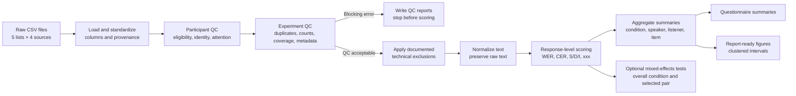
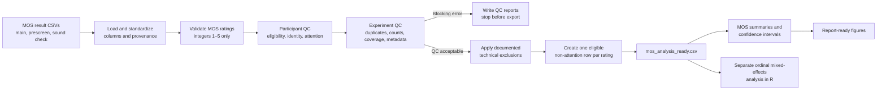

# Subjective human-evaluation analysis

This repository provides reusable, auditable pipelines for preparing and analyzing two kinds of subjective speech evaluation:

Transcription intelligibility experiments: quality control, text normalization, WER/CER scoring, summaries, figures, and optional mixed-effects analysis.

Mean Opinion Score (MOS) experiments: quality control, preparation of a
long-format analysis dataset, conventional MOS summaries, confidence
intervals, figures, and separate ordinal mixed-effects analysis in R.

Both workflows preserve the original CSV files, record the source of every loaded row, and stop before producing analysis-ready results when structural QC fails. Experiment-specific assumptions, column aliases, expected counts, exclusions, and thresholds are stored in JSON configuration files.

The current transcription experiment is configured for:

- 5 counterbalanced lists;
- 3 eligible participants per list;
- 5 audio conditions;
- 3 independent transcriptions for every `utterance_id × condition` pair; and
- hard eligibility requirements: `native_english=TRUE`, `headphones=TRUE`, and `heard_clearly=TRUE`.

The reusable template is `config/transcription_config.json`. The completed
pilot configuration is retained under `examples/configs/` as an audit record.

The current MOS experiment is configured for:
- 4 counterbalanced lists;
- 10 eligible participants per list;
- 4 audio conditions;
- 10 independent ratings for every utterance_id × condition pair; and
- hard eligibility requirements: native_english=TRUE, headphones=TRUE, and heard_clearly=TRUE.
The reusable template is `config/mos_config.json`. The completed pilot
configuration is retained under `examples/configs/` as an audit record.


## Repository description

### Pipeline overview

Transcription analysis



The main safety boundary is between QC and scoring. All QC reports are written first. If a structural requirement fails and `fail_on_structural_qc` is enabled, the run stops before producing scores or summaries.

MOS analysis



One Python command runs MOS QC, preprocessing, descriptive summaries, and
figures. The ordinal cumulative-link mixed model remains a separate command so
that inferential analysis can be rerun without repeating the descriptive
pipeline.

### Repository structure

```text
.
├── run_transcription_analysis.py
├── run_transcription_mixed_effects.py
├── run_mos_analysis.py
├── run_mos_clmm.py
├── config/
│   ├── transcription_config.json
│   └── mos_config.json
├── examples/configs/
│   ├── transcription_pilot_2026.json
│   └── mos_pilot_2026.json
├── src/transcription_analysis/
│   ├── cli.py
│   ├── config.py
│   ├── io_utils.py
│   ├── schema.py
│   ├── pipeline.py
│   ├── normalize.py
│   ├── metrics.py
│   ├── mixed_effects.py
│   ├── summarize.py
│   ├── timing.py
│   ├── questionnaire.py
│   └── visualize.py
├── src/mos_analysis/
│   ├── __init__.py
│   ├── analysis_cli.py
│   ├── pipeline.py
│   ├── workflow.py
│   ├── analysis.py
│   ├── summarize.py
│   └── visualize.py
├── tests/
│   ├── test_metrics.py
│   ├── test_mixed_effects.py
│   ├── test_pipeline.py
│   ├── test_mos_pipeline.py
│   └── test_timing.py
└── results/
```

| Module | Responsibility |
| --- | --- |
| `run_transcription_analysis.py`, `cli.py` | Parse transcription paths, protect input/output boundaries, run the pipeline, and report status. |
| `run_transcription_mixed_effects.py`, `mixed_effects.py` | Run transcription condition-effect and optional selected-pair tests. |
| `config.py` | Load the JSON configuration and validate required sections. |
| `io_utils.py` | Read and write CSV/JSON files and preserve source provenance. |
| `schema.py` | Resolve column aliases, create canonical fields, and identify duplicates. |
| `pipeline.py` | Coordinate loading, QC, exclusions, scoring, summaries, and outputs. |
| `normalize.py` | Apply conservative text normalization and locate configured name spans. |
| `metrics.py` | Calculate edit distance, S/D/I counts, WER, CER, and name-aware alignments. |
| `mixed_effects.py` | Test the overall condition effect and an optional selected condition pair while accounting for repeated listeners and utterances. |
| `summarize.py` | Aggregate results at condition, speaker, listener, item, and list levels. |
| `timing.py` | Produce non-blocking session-timing review diagnostics. |
| `questionnaire.py` | Summarize categorical responses and preserve free-text comments. |
| `visualize.py` | Generate SVG figures and the CSV data used to draw them. |
| `tests/` | Exercise reusable code on synthetic data; tests run separately from real analysis. |
| `run_mos_analysis.py`, `mos_analysis/analysis_cli.py` | Run MOS QC, preprocessing, summaries, and figures from one command. |
| `mos_analysis/workflow.py` | Coordinate the complete MOS descriptive workflow and write one combined manifest. |
| `mos_analysis/pipeline.py` | Load MOS sources, validate ratings, evaluate participant eligibility and attention checks, audit structure, apply documented exclusions, and create the analysis-ready dataset. |
| `mos_analysis/analysis.py`, `summarize.py`, `visualize.py` | Validate prepared ratings and create MOS summaries, confidence intervals, plot-data files, and SVG figures. |
| `run_mos_clmm.py`, `scripts/mos_ordinal_clmm.R` | Run the separate cumulative-link mixed-effects analysis on the analysis-ready dataset. |
| `config/transcription_config.json`, `config/mos_config.json` | Reusable configuration templates with aliases, expected counts, empty override lists, and display settings. |
| `examples/configs/` | Completed-study configuration records containing experiment-specific decisions and overrides. |
| `test_mos_pipeline.py` | Test valid MOS exports and blocking cases such as invalid ratings, failed attention checks, and failed eligibility. |

### Transcriptions - Data flow and auditability

Raw files are never edited. As rows are loaded, the pipeline records their containing `list_id`, `source_file`, and `source_row`. Alternative column names are mapped to canonical names through configuration rather than by renaming raw data.

The pipeline processes the data in the following stages, and each output builds on the previous stage:
1. `eligible_transcriptions.csv` contains non-attention responses retained after participant QC and approved row-level exclusions.
2. `normalized_transcriptions.csv` adds normalized and name-excluded scoring text without outcome metrics.
3. `transcription_scores.csv` adds response-level WER, CER, S/D/I counts, and diagnostics.
4. Summary tables aggregate response-level scores without replacing them as the source of truth.
5. Plot-data CSVs contain the exact values used in every figure.

### Transcriptions - Participant inclusion and experiment validity

The pipeline writes QC reports before calculating outcome metrics.

The three eligibility fields are `native_english`, `headphones`, and `heard_clearly`. All three must parse as true (accepted true values are `TRUE`, `true`, `1`, `yes`, `y`, and `t`). The final participant decision also requires matching participant/session identities, correct list membership, configured trial counts when enabled, and passing attention checks unless a documented override exists.

A participant is included only when:

- matching main, prescreen, and sound-check records exist for the same participant and session;
- those records belong to the same list;
- `native_english`, `headphones`, and `heard_clearly` are true;
- configured scored-trial and attention-check counts match; and
- every available attention check passes or has a valid explicit override.

A missing postquestionnaire is a warning. A questionnaire belonging to a conflicting list is an identity inconsistency. Every participant decision and reason appears in `01_qc/participant_qc.csv`.

After participant decisions, structural QC checks whether the resulting dataset still satisfies the experimental design. A participant may fail eligibility, but the experiment can proceed if a valid replacement preserves participant counts and counterbalanced coverage.

The pipeline checks:

- file and folder structure;
- required schemas;
- participant/session identity consistency across sources;
- reported list IDs against containing folders;
- duplicate participant records and repeated trials;
- included participant counts per list;
- expected conditions within every list;
- utterance × condition counterbalancing and independent ratings;
- consistent reference text and speaker metadata per utterance; and
- missing, negative, non-monotonic, unusually short, or unusually long timing.

Timing flags and missing postquestionnaires are review diagnostics. They do not automatically exclude a participant or stop analysis unless they reveal another identity or structural problem.

### Transcriptions - Normalization and scoring

The raw reference and transcription are always preserved. The default normalized score applies only:

- Unicode normalization;
- lowercasing;
- apostrophe standardization;
- apostrophe removal without splitting the word (`aren't` becomes `arent`);
- punctuation removal;
- whitespace cleanup;
- explicitly configured word equivalences; and
- configured personal-name exclusion from WER and CER.

It does not correct guessed words, perceptual errors, or `xxx`. Number conversion is not enabled. The current pre-agreed mappings are `theatre → theater`, `neighbours → neighbors`, and `spelt → spelled`. Record any additional mapping decision before comparing systems.

Each eligible non-attention response receives three score variants:

| Score variant | Purpose |
| --- | --- |
| `raw_wer`, `raw_cer` | Sensitivity view before normalization. |
| `wer_with_names`, `cer_with_names` | Normalized scoring with personal names included. |
| `wer`, `cer` | Primary normalized score after configured personal-name exclusion. |

#### WER and CER

```text
WER = (word substitutions + word deletions + word insertions) / reference words
CER = (character substitutions + character deletions + character insertions) / reference characters
```

CER removes spaces by default. Set `normalization.cer_remove_spaces` to `false` if spaces should count as characters. A blank transcription is retained and scored as deletion of the complete reference. A missing transcription column remains a blocking schema error.

#### Mixed-effects condition analysis

A post-hoc analysis fits linear mixed-effects models for WER and CER:

```text
WER or CER ~ condition + speaker + (1 | listener) + (1 | utterance)
```

Condition and speaker are fixed effects. Listener and utterance are crossed random intercepts, accounting for repeated measurements from the same listener and repeated use of the same utterance. The overall condition result is a joint Wald chi-square test of all condition coefficients; significance means at least one condition differs.

A selected comparison tests one condition against another within the same fitted model. It reports `FIRST − SECOND`, its standard error, 95% confidence interval, Wald z statistic, and two-sided p-value. A negative difference means the first condition has the lower error rate. No multiplicity correction is applied because one comparison is selected per run; choose that pair before inspecting its p-value.

#### Personal-name exclusion

Names in `normalization.excluded_name_phrases` are matched in the normalized reference and represented as wildcard spans. A wildcard can absorb the listener's rendering of that name, including a misspelling, without contributing an error. Surrounding words remain scored.

Review `reference_text_scored`, `transcription_scored`, `excluded_name_phrases`, and the difference between name-included and primary scores. Because wildcard alignment intentionally removes uncertain name spans, review every name-excluded response before final reporting to ensure neighboring non-name errors were not absorbed.

#### Macro and pooled results

`mean_wer` and `mean_cer` are macro averages: every response-level error rate receives equal weight.

`micro_wer` is pooled:

```text
micro WER = total word errors / total reference words
```

Longer references contribute more weight to pooled rates. The condition WER/CER figure and error-composition figure both use means of response-level rates. Therefore, the stacked substitution, deletion, and insertion rates equal the reported macro mean WER or CER for each condition.

#### `xxx` diagnostics

The exact normalized token `xxx` is included in WER/CER as an ordinary hypothesis token and reported separately. Diagnostics include any `xxx`, whole-response `xxx`, token count, and token rate. Variants such as `xx`, `xxxxx`, or free-text descriptions of uncertainty are not automatically treated as `xxx`.

### Transcriptions - Outputs, questionnaire, and figures

Scores are summarized by condition, speaker, speaker-condition, listener, listener-condition, utterance, utterance-condition, list-condition, and gender-condition when gender is available. Outputs include sample counts, macro WER/CER, pooled word-error rates, S/D/I rates, `xxx`, perfect-transcription rates, timing, and playback diagnostics.

The postquestionnaire remains descriptive. Categorical responses are counted overall and within each list. Comments are preserved verbatim with participant/session identifiers. Labels such as “Very easy” and “Good” are not converted to numbers because equal spacing between categories has not been established. Questionnaire responses provide diagnostic context rather than automatically changing intelligibility scores.

The pipeline generates six vector figures:

- response-level WER and CER box-and-dot distributions by condition;
- gender × condition mean WER and CER;
- speaker × condition mean WER and CER;
- word-level and character-level S/D/I composition by condition;
- partial and whole-response `xxx` rates by condition; and
- inter-listener WER/CER variation by condition.

Error-rate intervals use a participant-clustered percentile bootstrap with a fixed random seed. Participants are sampled with replacement and their responses remain together within each resample. These intervals describe listener-level uncertainty; they do not replace a preregistered mixed-effects analysis. Gender and speaker results describe the four speakers in this experiment and must not be interpreted as population-level gender effects.

#### Inter-listener consistency

The pipeline measures variation in WER and CER across listeners for each `utterance_id × condition` group. It reports the sample standard deviation and range of the listener scores.

The condition-level summary uses only groups containing the configured number of distinct listeners. Incomplete groups remain visible in the detailed utterance-condition output and are counted separately.

Lower variation indicates that listeners produced more similar accuracy scores for the same audio. This analysis complements the participant-clustered confidence intervals: confidence intervals describe uncertainty in a condition-level mean, whereas inter-listener variation describes consistency among listeners evaluating the same audio. With only three listeners per group, these values are descriptive and should not be interpreted as formal reliability coefficients.

### Transcriptions - Output structure

```text
analysis_output/
├── run_manifest.json
├── OUTPUT_GUIDE.md
├── 01_qc/
│   ├── qc_summary.txt
│   ├── source_file_inventory.csv
│   ├── participant_qc.csv
│   ├── qc_issues.csv
│   ├── duplicate_transcriptions.csv
│   ├── attention_check_audit.csv
│   ├── attention_check_summary.csv
│   ├── technical_exclusion_audit.csv
│   ├── session_timing_qc.csv
│   ├── list_condition_coverage.csv
│   ├── utterance_condition_coverage.csv
│   └── utterance_metadata_audit.csv
├── 02_preprocessed/
│   ├── eligible_transcriptions.csv
│   └── normalized_transcriptions.csv
├── 03_scores/
│   ├── transcription_scores.csv
│   └── xxx_diagnostics.csv
├── 04_summaries/
│   ├── by_condition.csv
│   ├── by_speaker.csv
│   ├── by_speaker_condition.csv
│   ├── by_gender_condition.csv
│   ├── by_listener.csv
│   ├── by_listener_condition.csv
│   ├── by_utterance.csv
│   ├── by_utterance_condition.csv
│   ├── by_list.csv
│   ├── plays_wer_summary.csv
│   ├── inter_listener_consistency_by_utterance_condition.csv
│   ├── inter_listener_consistency_by_condition.csv
│   └── technical_exclusion_sensitivity.csv
├── 05_questionnaire/
│   ├── eligible_responses.csv
│   ├── categorical_summary.csv
│   └── comments.csv
├── 06_figures/
│   ├── condition_plot_data.csv
│   ├── error_rate_distribution_plot_data.csv
│   ├── gender_condition_plot_data.csv
│   ├── speaker_condition_plot_data.csv
│   ├── inter_listener_consistency_plot_data.csv
│   ├── error_rate_distributions.svg
│   ├── gender_error_rates.svg
│   ├── speaker_error_rates.svg
│   ├── error_composition.svg
│   ├── xxx_rates.svg
│   └── inter_listener_consistency.svg
└── 07_mixed_effects/                  # Optional; generated separately
    ├── condition_effect_tests.csv
    ├── selected_condition_comparison.csv  # Only with --compare-conditions
    ├── condition_effect_summary.txt
    └── model_audit.json
```

`transcription_scores.csv` is the response-level analytical source of truth. `by_condition.csv` is the primary descriptive system comparison. `technical_exclusion_sensitivity.csv` is created only when approved technical exclusions are applied, and `by_gender_condition.csv` is created only when gender metadata are available.

For mixed effects, `condition_effect_tests.csv` contains the omnibus WER/CER tests, `selected_condition_comparison.csv` contains the optional chosen pair, `condition_effect_summary.txt` gives the plain-language conclusions, and `model_audit.json` records the model specification, convergence, diagnostics, selected pair, and input hashes.

### MOS preprocessing and analysis
The MOS and transcription pipelines use similar eligibility, identity, attention-check, timing, exclusion, and structural-QC rules. The main differences concern the outcome being prepared.

The MOS pipeline produces a quality-controlled long-format dataset, descriptive summaries, confidence intervals, and figures. The final ordinal mixed-effects model is run separately with `run_mos_clmm.py`.

The MOS data pass through the following stages:

1. Raw CSV files are loaded from `main`, `prescreen`, `sound_check`, and, when available, `postquestionnaire`.
2. Column aliases are resolved to standard internal names.
3. Participant and session identities are checked across the different data sources.
4. MOS ratings are validated against the configured integer scale of 1–5.
5. Participant eligibility and attention-check performance are evaluated.
6. Duplicate ratings, expected counts, condition coverage, stimulus coverage, metadata consistency, timing, and technical exclusions are audited.
7. Attention-check rows, excluded participants, and approved technical-exclusion rows are removed from the analysis dataset.
8. If structural QC passes, the pipeline writes `mos_analysis_ready.csv`.
9. The same command creates descriptive summaries, confidence intervals, and figures.
10. The prepared CSV can then be passed to the repository's separate CLMM command.

Participant eligibility requires:

- matching `participant_id` and `session_id` across the available sources;
- `native_english=TRUE`;
- `headphones=TRUE`;
- `heard_clearly=TRUE`;
- the configured number of experimental and attention-check trials; and
- all attention checks passing, unless a documented manual override has been configured.

The pipeline also checks:

- required folders and columns;
- reported list IDs against their containing folders;
- participants appearing in conflicting lists or sessions;
- expected participant counts per list;
- expected conditions within each list;
- independent ratings per `item_id × speaker_id × condition`;
- consistent item metadata;
- duplicate ratings;
- missing or invalid rating values; and
- missing, negative, non-monotonic, unusually short, or unusually long timing.

Raw files remain unchanged. The exported data include `source_file` and `source_row`, allowing every prepared rating to be traced back to its original CSV row.

MOS input files must provide canonical unique `item_id` values. Historical
one-off data migrations are not part of the reusable pipeline.

#### MOS attention checks

Attention-check rows are audited but never included in `mos_analysis_ready.csv`.

MOS attention checks are identified using either:

- an `is_attention_check` field; or
- a `trial_type` value configured under `attention_trial_values`.

When `expected_response` is available, the submitted `mos_rating` must match that expected integer exactly. A stored pass/fail field is used only when an expected response is unavailable.

A failed check may be overridden only after manual review. The failure remains visible, and the reason for the override is preserved in the QC outputs.

#### MOS rating validity

The MOS pipeline accepts only the configured integer scale:

```text
1, 2, 3, 4, 5
```

#### MOS output structure

```text
mos_analysis_output/
├── run_manifest.json
├── OUTPUT_GUIDE.md
├── 01_qc/
│   ├── qc_summary.txt
│   ├── qc_issues.csv
│   ├── source_file_inventory.csv
│   ├── participant_qc.csv
│   ├── rating_value_audit.csv
│   ├── attention_check_audit.csv
│   ├── duplicate_ratings.csv
│   ├── technical_exclusion_audit.csv
│   ├── session_timing_qc.csv
│   ├── list_condition_coverage.csv
│   ├── stimulus_condition_coverage.csv
│   └── item_metadata_audit.csv
├── 02_preprocessed/
│   └── mos_analysis_ready.csv
├── 03_summaries/
└── 04_figures/
```
| File | Purpose |
| --- | --- |
| `run_manifest.json` | Records input and output paths, final QC status, row counts, applied overrides and exclusions, and resolved source columns. |
| `OUTPUT_GUIDE.md` | Provides a short guide to the generated output directory. |
| `qc_summary.txt` | Gives the plain-language QC verdict and identifies the main blockers or exclusions. |
| `qc_issues.csv` | Lists every QC error and warning with its code and explanation. |
| `source_file_inventory.csv` | Lists the discovered source files, row counts, and available columns. |
| `participant_qc.csv` | Records whether each participant was included and explains every exclusion. |
| `rating_value_audit.csv` | Shows whether each submitted MOS value is a valid integer from 1 to 5. |
| `attention_check_audit.csv` | Records expected and submitted attention-check ratings, pass/fail decisions, and overrides. |
| `duplicate_ratings.csv` | Lists repeated participant/session/item/speaker/condition ratings. |
| `technical_exclusion_audit.csv` | Records configured technical exclusions, match counts, reasons, and whether they were applied. |
| `session_timing_qc.csv` | Reports session duration, trial timing, and timing warnings for manual review. |
| `list_condition_coverage.csv` | Shows whether every configured list contains all expected conditions. |
| `stimulus_condition_coverage.csv` | Reports the number of independent ratings for every item/speaker/condition combination. |
| `item_metadata_audit.csv` | Identifies inconsistent item-level metadata such as conflicting reference text. |

#### Analysis-ready file

`02_preprocessed/mos_analysis_ready.csv` is created only when structural QC passes.

It contains one eligible, non-attention, non-excluded experimental MOS rating per row. The main analysis columns are:

```text
participant_id
session_id
list_id
item_id
condition
speaker_id
mos_rating
```

Additional metadata and provenance columns are preserved when available:

```text
item_order
audio_file
gender
language
reference_text
question
plays_used
response_time_sec
study_elapsed_sec
shown_at
submitted_at
source_file
source_row
```

This file is the input for the ordinal mixed-effects analysis in R. It should not be created manually when QC is blocked.

## Instructions for using the repository

### Requirements

- Python 3.9 or newer;
- no third-party packages for the transcription or MOS descriptive pipelines;
- optional mixed-effects dependencies installed separately; and
- a new or empty output directory for each run.

### Expected input folders

Place this repository beside `results`, or pass another path with `--results-root`.

#### Transcription experiment

```text
results/
├── pilot_transcription_experiment_list1/
│   ├── main/*.csv
│   ├── prescreen/*.csv
│   ├── sound_check/*.csv
│   └── postquestionnaire/*.csv
├── pilot_transcription_experiment_list2/
│   └── ...
└── pilot_transcription_experiment_list5/
    └── ...
```

#### MOS experiment

```text
results/
├── pilot_mos_list1/
│   ├── main/*.csv
│   ├── prescreen/*.csv
│   ├── sound_check/*.csv
│   └── postquestionnaire/*.csv
├── pilot_mos_list2/
│   └── ...
├── pilot_mos_list3/
│   └── ...
└── pilot_mos_list4/
    └── ...
```

Each folder may contain one CSV per participant. Files are discovered using `*.csv`; filenames do not control participant or session joins.

The two pipelines share the same eligibility sources:

| Source | Shared required fields |
| --- | --- |
| `prescreen` | `participant_id`, `session_id`, `native_english`, `headphones` |
| `sound_check` | `participant_id`, `session_id`, `heard_clearly` |
| `postquestionnaire` | `participant_id`, `session_id`; response columns may vary by experiment |

Their main-result requirements differ:

| Experiment | Required `main` fields |
| --- | --- |
| Transcription | `participant_id`, `session_id`, `item_id`/`utt_id`/`utterance_id`, `condition`, `speaker_id`, `reference_text`, `transcription` |
| MOS | `participant_id`, `session_id`, `item_id`, `condition`, `speaker_id`, `mos_rating` |

Alternative source-column names can be listed under `column_aliases` in the relevant configuration file. Raw CSV headers do not need to be renamed.

After every run, inspect `run_manifest.json → resolved_columns` to confirm which raw columns were selected.

### Configure the experiment

Use the configuration file corresponding to the experiment:

| Experiment | Configuration |
| --- | --- |
| Transcription | `config/transcription_config.json` |
| MOS | `config/mos_config.json` |

Copy the appropriate template before adapting it for a new experiment. The
files in `examples/configs/` document completed pilot decisions and should not
be used as generic starting points.

Use `null` only when a design requirement is not yet known. For the final analysis, use explicit expected counts so missing data become visible during QC.

### Test the code

Tests run separately from the real analysis and use temporary synthetic data. They do not read or modify `results/` or an existing analysis-output directory.

Run all tests:

```bash
PYTHONPATH=src python3 -m unittest discover -s tests -v
```

Run only the MOS tests:

```bash
PYTHONPATH=src python3 -m unittest tests.test_mos_pipeline -v
```

Passing tests confirms that the implemented rules work on controlled examples. It does not replace reviewing the QC and prepared rows from the real experiment.

### Run the transcription analysis

```bash
python3 run_transcription_analysis.py \
  --results-root ./results \
  --output-root ./analysis_output \
  --config ./config/transcription_config.json
```

### Run the MOS analysis

```bash
python3 run_mos_analysis.py \
  --results-root ./results \
  --output-root ./mos_analysis_output \
  --config ./config/mos_config.json
```

Both pipelines require separate, non-overlapping input and output directories. Use a new or empty output directory for every run. Raw result files are never modified.

The MOS command creates QC reports, the analysis-ready dataset, descriptive
summaries, confidence intervals, and figures. Run `run_mos_clmm.py` separately
when ordinal mixed-effects inference is required.


### Run the transcription mixed-effects analysis

Run this after the transcription pipeline has created `03_scores/transcription_scores.csv`.

Install the optional dependencies once:

```bash
python3 -m pip install -e '.[mixed-effects]'
```

For the overall condition effect:

```bash
python3 run_transcription_mixed_effects.py \
  --scores ./analysis_output/03_scores/transcription_scores.csv \
  --output-root ./analysis_output/07_mixed_effects \
  --config ./config/transcription_config.json
```

To compare one selected condition pair:

```bash
python3 run_transcription_mixed_effects.py \
  --scores ./analysis_output/03_scores/transcription_scores.csv \
  --output-root ./analysis_output/07_mixed_effects_conditionA_vs_conditionB \
  --config ./config/transcription_config.json \
  --compare-conditions condition_A condition_B
```

### Run the MOS ordinal mixed-effects analysis

Run this after the MOS pipeline has created
`02_preprocessed/mos_analysis_ready.csv`:

```bash
python3 run_mos_clmm.py \
  --input ./mos_analysis_output/02_preprocessed/mos_analysis_ready.csv \
  --output-root ./mos_clmm_output \
  --reference-condition mantis_v5_w2s_baseline_E2E_apt
```

This command remains separate so the CLMM can be rerun without repeating QC,
descriptive summaries, or figures.

### QC

Both pipelines apply the same core QC principles:

- raw CSV files remain unchanged;
- participant and session identities must agree across sources;
- `native_english`, `headphones`, and `heard_clearly` must all parse as true;
- expected participant and trial counts must be satisfied;
- attention checks must pass unless a documented override is approved;
- duplicates and incomplete condition coverage are reported;
- technical exclusions must match an exact row and include a reason; and
- timing flags are reported for review but do not automatically exclude a participant.

The main outcome-specific difference is:

- the transcription pipeline validates and scores free-text transcriptions;
- the MOS pipeline accepts only integer ratings from 1 to 5 and does not transform them.

Blank transcriptions remain valid responses and are scored as complete deletions. Blank or invalid MOS ratings are blocking data errors.

#### Reading the QC summary

Start with the appropriate summary:

```text
analysis_output/01_qc/qc_summary.txt
mos_analysis_output/01_qc/qc_summary.txt
```

The possible outcomes are:

- `QC PASSED`: all configured eligibility and structural requirements passed.
- `QC PASSED WITH EXCLUSIONS`: documented exclusions occurred, but the remaining data satisfy the configured design.
- `QC BLOCKED`: structural requirements failed, so downstream analytical outputs were not created.

The same verdict is printed in the terminal and stored in `run_manifest.json`.

If QC is blocked or contains exclusions:

1. open `01_qc/qc_issues.csv`;
2. identify the reported issue code;
3. open the corresponding detailed audit;
4. correct the input or configuration; and
5. rerun using a new output directory.

Do not manually reconstruct a downstream analysis file when QC is blocked.

#### Attention-check overrides

Use an attention-check override only after manual review. Add the exact participant and session to `attention_check_include_overrides` in the relevant configuration:

```json
{
  "list_id": "1",
  "participant_id": "participant-id",
  "session_id": "session-id",
  "reviewed_at": "YYYY-MM-DD",
  "reason": "Why inclusion was approved"
}
```

The failed check remains visible in the attention-check audit. An override permits participant inclusion only when every other eligibility and structural requirement passes.

Attention-check rows are always excluded from the analytical outcome dataset.

#### Technical exclusions

Use a technical exclusion only for a confirmed row-level problem, such as an audio file that did not play.

For transcription, identify the affected row with its utterance and condition. For MOS, include the item, speaker, and condition:

```json
{
  "list_id": "1",
  "participant_id": "participant-id",
  "session_id": "session-id",
  "item_id": "item-id",
  "speaker_id": "speaker-id",
  "condition": "condition-name",
  "reviewed_at": "YYYY-MM-DD",
  "reason": "Evidence supporting this exclusion"
}
```

The raw CSV remains unchanged. The exclusion and its reason are preserved in `technical_exclusion_audit.csv`.

### Review the completed output

#### Transcription analysis

Review transcription outputs in this order:

1. `01_qc/qc_summary.txt` and `01_qc/qc_issues.csv`;
2. participant, attention, exclusion, timing, and coverage audits;
3. `02_preprocessed/normalized_transcriptions.csv`;
4. `03_scores/transcription_scores.csv`;
5. `04_summaries/by_condition.csv`;
6. speaker-, listener-, list-, and utterance-level summaries;
7. questionnaire outputs; and
8. figures together with their plot-data CSVs.

If mixed-effects analysis was run, review:

1. `condition_effect_summary.txt`;
2. `condition_effect_tests.csv`;
3. the optional `selected_condition_comparison.csv`; and
4. `model_audit.json`.

#### MOS analysis

Review MOS outputs in this order:

1. `01_qc/qc_summary.txt` and `01_qc/qc_issues.csv`;
2. `participant_qc.csv`;
3. `rating_value_audit.csv`;
4. `attention_check_audit.csv`;
5. duplicate, exclusion, timing, and coverage audits;
6. `run_manifest.json → resolved_columns`; and
7. `02_preprocessed/mos_analysis_ready.csv`;
8. `03_summaries/mos_by_condition.csv` and supporting summaries; and
9. the report-ready figures and plot data in `04_figures/`.

For selected rows in `mos_analysis_ready.csv`, use `source_file` and `source_row` to verify the prepared value against the original CSV.

`mos_analysis_ready.csv` is then used by the separate `run_mos_clmm.py`
command for ordinal mixed-effects analysis.
